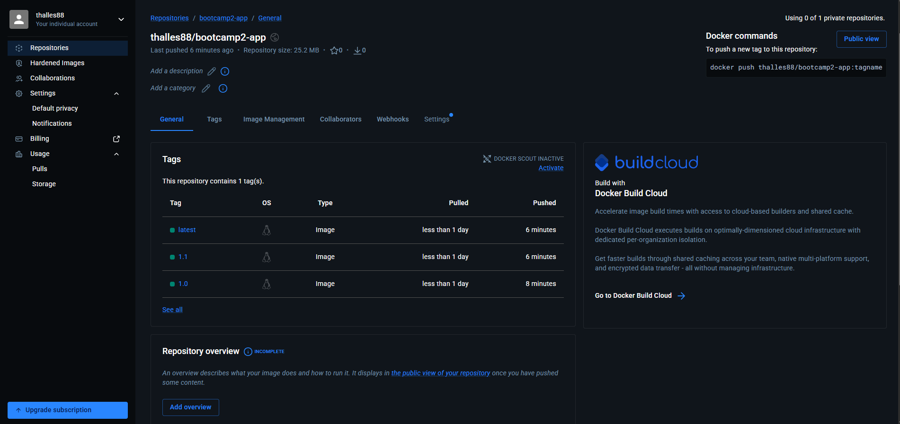
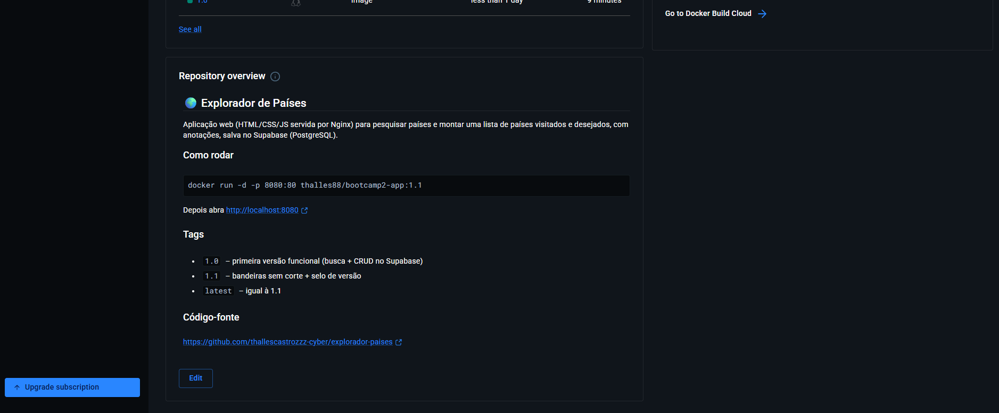
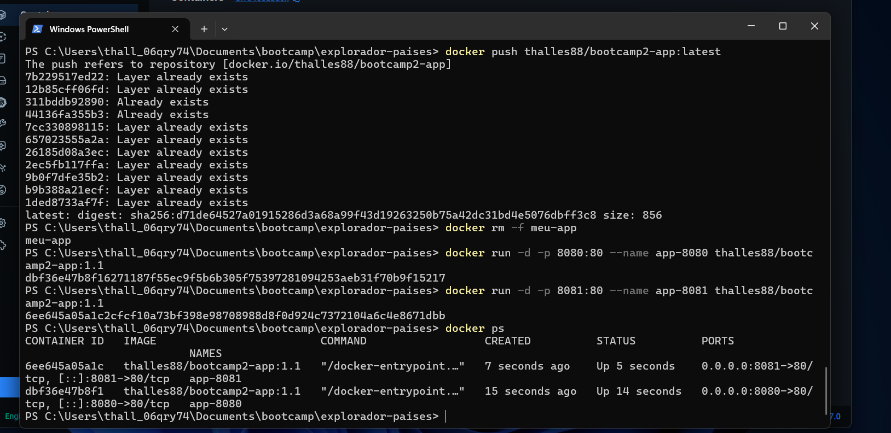

# 🌍 Explorador de Países

> Bootcamp II · Etapa 02 — Persistência + Docker (evolução direta do projeto da Etapa 01)

Aplicação web que busca informações de qualquer país numa **base pública de países** ([mledoze/countries](https://github.com/mledoze/countries), servida pela CDN jsDelivr, com bandeiras do [flagcdn](https://flagcdn.com)) e permite montar uma lista pessoal de **países visitados e desejados**, com anotações — tudo salvo num banco **PostgreSQL (Supabase)**. A aplicação é empacotada numa imagem **Docker** (Nginx) publicada no **Docker Hub**.

## 🔗 Links

| Item | Link |
|------|------|
| (1) Repositório GitHub | https://github.com/thallescastrozzz-cyber/explorador-paises |
| (2) Aplicação no GitHub Pages | https://thallescastrozzz-cyber.github.io/explorador-paises/ |
| (3) Repositório no Docker Hub | https://hub.docker.com/r/thalles88/bootcamp2-app |

## ▶️ (4) Como executar (comando para o avaliador)

```bash
docker run -d -p 8080:80 thalles88/bootcamp2-app:1.1
```

Depois abra **http://localhost:8080** no navegador.

> Tags disponíveis: `1.0` (primeira versão funcional), `1.1` (melhorias) e `latest` (= 1.1).

---

## 💾 (5) Persistência de dados

| Item | Detalhe |
|------|---------|
| **Banco escolhido** | **Supabase** — PostgreSQL gerenciado, região South America (São Paulo) |
| **Conexão** | Biblioteca `@supabase/supabase-js` direto no frontend (sem servidor próprio) |
| **Tabela** | `favoritos` (script completo em [`supabase.sql`](supabase.sql)) |

### Estrutura da tabela `favoritos`

| Coluna | Tipo | Descrição |
|--------|------|-----------|
| `id` | `bigint` (identity, PK) | Identificador gerado pelo banco |
| `criado_em` | `timestamptz` (default `now()`) | Data em que o país foi salvo |
| `nome_item` | `text` | Nome do país em português |
| `dados_extra` | `jsonb` | `codigo` (ISO cca3), `bandeira` (URL), `capital`, `regiao`, `status` (`visitado`/`desejado`) e `anotacao` |

### O que é salvo e operações (CRUD)

- **C — Criar:** ao buscar um país, os botões **“✈️ Visitei”** e **“⭐ Quero ir”** inserem o país na tabela (com bloqueio de duplicados).
- **R — Listar:** a seção **“Meus países”** carrega os registros do banco ao abrir a página, com filtros *Todos / Visitados / Desejados* e contadores.
- **U — Atualizar (bônus):** trocar o status (visitado ⇄ desejado) e escrever uma **anotação pessoal** sobre o país.
- **D — Excluir:** botão **“Excluir”** em cada item remove o registro do banco.

Os dados **sobrevivem ao fechamento do navegador** e aparecem em qualquer dispositivo, pois ficam no PostgreSQL — não é usado `localStorage`.

### ℹ️ Fonte dos dados de países

A versão inicial usava a API REST Countries (`/v3.1`), mas essas versões foram desativadas e a nova (`/v5`) exige cadastro e chave de API. Para não expor uma chave no frontend, a busca passou a usar a base aberta **mledoze/countries** (a mesma que originou a REST Countries), carregada uma única vez pela CDN jsDelivr e filtrada no navegador — inclusive por nomes em português e sem acento (ex.: "japao").

### ⚠️ Limitação conhecida (RLS)

As políticas de acesso (Row Level Security) estão **abertas para o papel `anon`** (leitura, inserção, edição e exclusão), conforme permitido nesta etapa. Isso significa que qualquer pessoa com a URL da aplicação pode alterar a lista, e todos os visitantes compartilham a mesma lista. Em produção, o correto seria adicionar autenticação (Supabase Auth) e uma coluna `user_id` com políticas do tipo `auth.uid() = user_id`. A chave usada no código é a **anon public**, que foi feita para ficar no frontend.

---

## 🐳 Docker

```bash
# Construir a imagem
docker build -t bootcamp2-app .

# Rodar localmente
docker run -d -p 8080:80 --name meu-app bootcamp2-app
# → http://localhost:8080
```

O [`Dockerfile`](Dockerfile) usa `nginx:alpine` e copia `index.html`, `style.css` e `script.js` para `/usr/share/nginx/html/`.

---

## 🎯 (6) Sidequests

### SQ1 · `.dockerignore`

O arquivo [`.dockerignore`](.dockerignore) exclui do *build context* tudo o que a aplicação não precisa para rodar: a pasta `.git`, arquivos `.md` (README, rascunhos), `supabase.sql`, a pasta `evidencias/`, configurações de editor e lixo do sistema.

**Por que isso deixa a imagem menor e o build mais rápido?** Ao rodar `docker build`, o Docker primeiro envia toda a pasta do projeto (o *contexto*) para o daemon. Sem o `.dockerignore`, a pasta `.git` — que guarda todo o histórico e cresce a cada commit — e os prints da pasta `evidencias/` seriam enviados a cada build, deixando-o mais lento. Além disso, se algum dia o Dockerfile usar `COPY . .`, esses arquivos entrariam na imagem, aumentando seu tamanho e podendo expor informações que não deveriam ser publicadas. Menos arquivos no contexto também significa que mudanças só no README não invalidam o cache das camadas.

### SQ2 · Versionamento de imagem

Foram publicadas três tags no Docker Hub:

| Tag | Conteúdo |
|-----|----------|
| `1.0` | Primeira versão funcional: busca + CRUD (criar, listar, excluir) no Supabase |
| `1.1` | Melhoria: filtros *Visitados/Desejados*, contadores, anotações e troca de status (update) |
| `latest` | Aponta para a `1.1` |

Evidência: 

### SQ3 · Descrição no Docker Hub

O *overview* do repositório no Docker Hub explica o que é a aplicação, traz o comando `docker run` pronto para copiar e o link deste repositório GitHub.

Evidência: 

### SQ4 · Explorando a orquestração

Dois containers da mesma imagem rodando ao mesmo tempo, nas portas 8080 e 8081:

```bash
docker run -d -p 8080:80 --name app-8080 thalles88/bootcamp2-app:1.1
docker run -d -p 8081:80 --name app-8081 thalles88/bootcamp2-app:1.1
docker ps
```

Evidência: 

**Se eu tivesse 100 containers, como gerenciaria?**

Gerenciar 100 containers com `docker run` manual seria inviável: eu teria de escolher portas, reiniciar o que caísse e distribuir o tráfego sozinho. Para isso existe um **orquestrador**, e o mais usado é o **Kubernetes**. Ele organiza várias máquinas (os *nós*) em um **cluster**, que funciona como um único grande computador: eu descrevo o estado desejado em um arquivo e o Kubernetes decide em qual máquina cada container vai rodar. A menor unidade que ele gerencia é o **pod**, que envolve um ou mais containers que compartilham rede e armazenamento. Em vez de criar pods à mão, eu declararia que quero **100 réplicas** da imagem `bootcamp2-app:1.1` (usando um *Deployment*); o Kubernetes mantém esse número sozinho, recriando automaticamente qualquer réplica que falhe. Um *Service* distribuiria o tráfego entre as réplicas por um único endereço, sem que eu precise controlar portas como 8080 e 8081, e para lançar a versão `1.2` bastaria trocar a tag: ele substitui as réplicas aos poucos, sem derrubar a aplicação (*rolling update*).

---

## 🧱 Tecnologias

HTML5 · CSS3 · JavaScript (ES Modules) · [mledoze/countries](https://github.com/mledoze/countries) via jsDelivr · [flagcdn](https://flagcdn.com) · Supabase (PostgreSQL) · Docker · Nginx · GitHub Pages

## 📁 Estrutura

```
.
├── index.html        # estrutura da página
├── style.css         # estilos
├── script.js         # busca na API + CRUD no Supabase
├── supabase.sql      # criação da tabela e políticas RLS
├── Dockerfile        # imagem Nginx com a aplicação
├── .dockerignore     # o que fica fora do build
├── evidencias/       # prints das sidequests
└── README.md
```

## 👤 Autor

Thalles de Castro — Bootcamp II · CEUB
